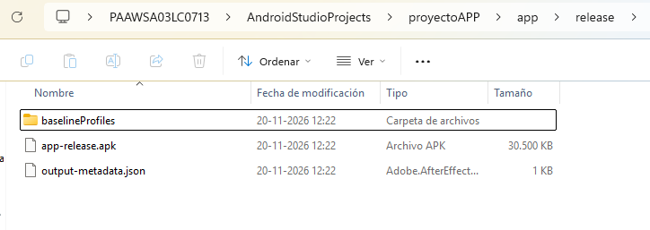
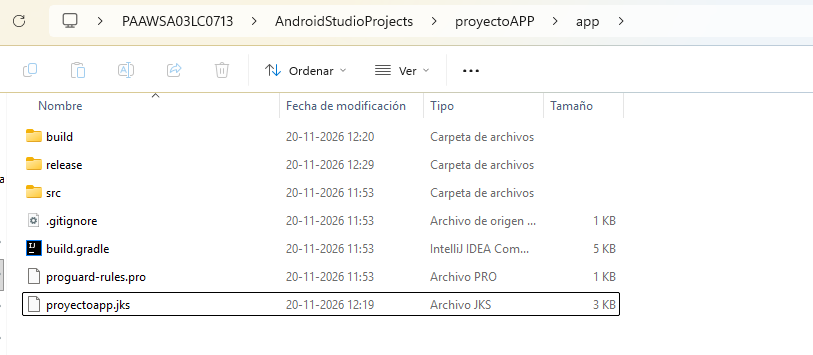

# proyecto_evaluacion_APP

App Android para registrar y hacer seguimiento de solicitudes de clientes (caso DSY1105 – Gestión móvil y seguimiento de solicitudes de clientes). Todos los datos son ficticios.

## Integrantes

- Matias Acevedo
- Alexander Mejias

## Funcionalidades

- Login con validaciones y 3 perfiles: Cliente, Administrador y Técnico.
- Crear y editar solicitudes con código único, estado inicial "Recibida" y foto de evidencia desde la galería.
- **Catálogo externo de servicios (API REST con Retrofit):** opción "Abrir catálogo" en el menú (todos los perfiles) y botón "Abrir catálogo" en el formulario, donde al tocar un servicio se completan el servicio y la categoría. Si el catálogo está vacío, se puede recargar.
- Lista de solicitudes con búsqueda, filtros y aviso de solicitudes atrasadas.
- Detalle con historial de cambios y código QR propio de cada solicitud.
- Administrador: clasificar, priorizar, asignar técnico, cerrar, eliminar y ver el resumen general.
- Técnico: cambiar estado, registrar avances, adjuntar evidencia (imagen) y resolver.
- Escanear el QR de una solicitud con la cámara.
- Datos guardados en el celular con Room.
- Pruebas unitarias (Kotest + MockK) y pruebas de interfaz (Compose).
- APK release firmado con la llave `app/proyectoapp.jks`.

## Tecnologías

Kotlin, Jetpack Compose (Material 3), MVVM, Navigation Compose, Room, Retrofit, CameraX + ML Kit (leer QR), ZXing (generar QR), Kotest y MockK.

## Endpoints utilizados

### API externa: catálogo de servicios

| Método | URL | Qué hace |
|---|---|---|
| GET | `https://raw.githubusercontent.com/mati4769/proyectoAPP/main/catalogo/servicios.json` | Devuelve el catálogo de servicios (id, servicio, categoría, descripción) |

El catálogo está en la carpeta `catalogo/` de este repositorio y la app lo consume con Retrofit (`ApiService` + `RetrofitInstance` + `ServicioRepository`). No se mezcla con los datos locales de Room.

## Cómo ejecutar

1. Abrir Android Studio y en la pantalla de inicio elegir **Clone Repository**. Si ya hay un proyecto con el mismo nombre, se tiene que borrar desde archivos.
2. Pegar la URL `https://github.com/mati4769/proyectoAPP.git` y presionar **Clone**.
3. Esperar que termine de sincronizar Gradle.
4. Elegir un emulador y presionar ▶ Run.

### Pruebas

- Unitarias: clic derecho en `com (test)` → **Run Tests**.
- De interfaz: con el emulador abierto, clic derecho en `com (androidTest)` → **Run Tests**.

## APK firmado

- Llave: `app/proyectoapp.jks` (alias `proyectoapp`).
- Configuración: `signingConfigs` en `app/build.gradle.kts`.
- APK: `app/release/app-release.apk`.

## Cuentas de prueba

| Correo | Contraseña | Perfil |
|---|---|---|
| cliente@pymedemo.cl | cliente123 | Cliente |
| cliente2@comerciodemo.cl | cliente456 | Cliente |
| admin@techsoluciones.cl | admin123 | Administrador |
| tecnico@techsoluciones.cl | tecnico123 | Técnico |
| tecnico2@techsoluciones.cl | tecnico456 | Técnico |
